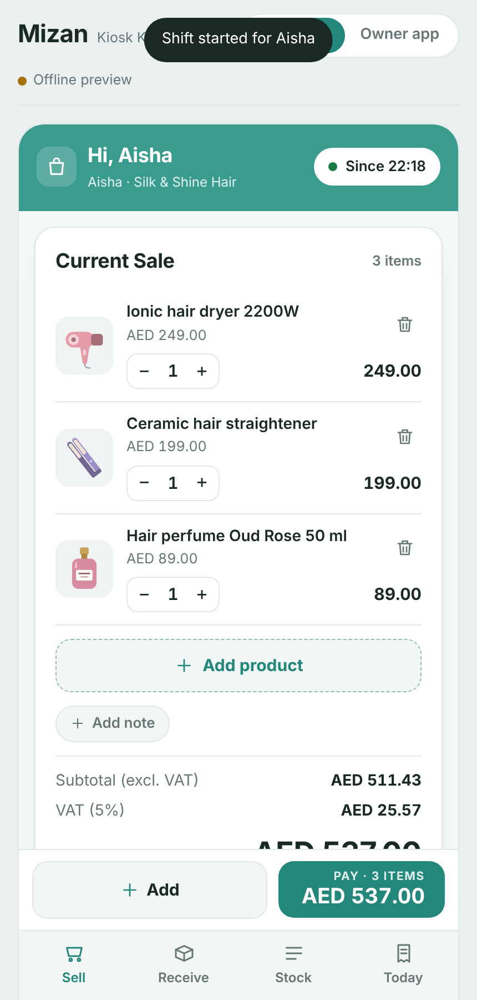
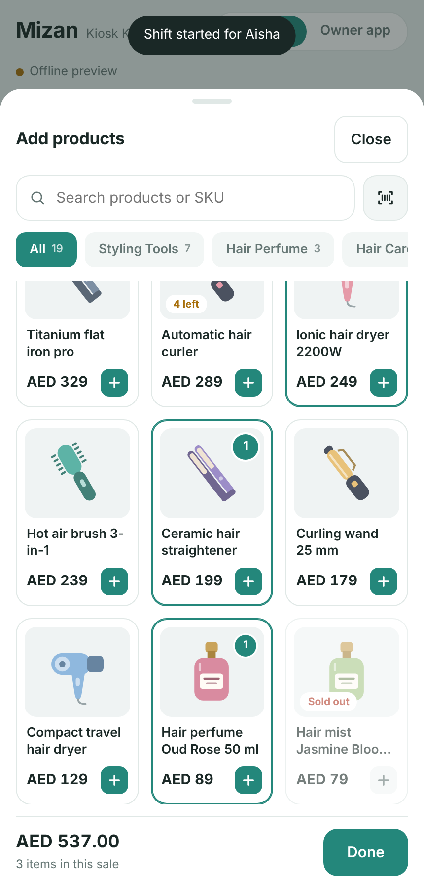
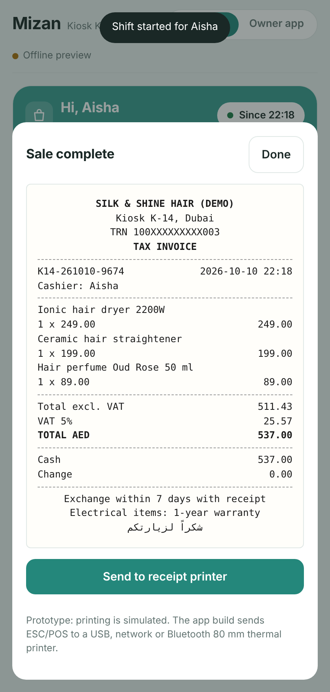
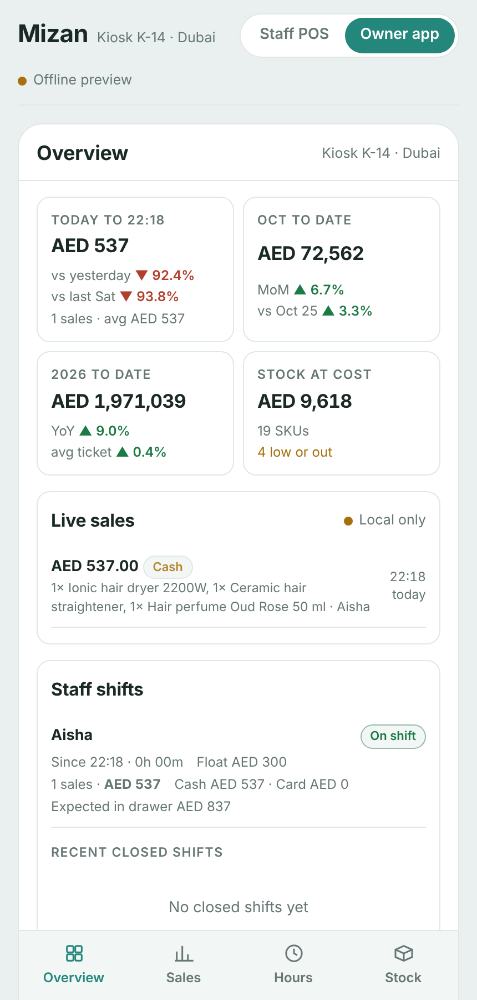

# Mizan Retail: POS & Sales Analytics

A mobile prototype for a retail kiosk in Dubai, with two apps in one page:

- **Staff POS:** shift on/off, product picker with picture tiles, cash and card payment, VAT receipts, receiving stock, and a stock list.
- **Owner app:** live sales, staff shifts, day/month/year comparisons, sales by hour of day, and stock analytics.

The demo catalog is a hair products kiosk ("Silk & Shine Hair"): dryers, straighteners, curlers, hair perfume, oils, brushes and accessories.

| Staff POS: sale | Staff POS: add products | Receipt | Owner app |
|---|---|---|---|
|  |  |  |  |

## Run it

There is no build step. The whole app is `index.html`.

- **Locally:** open `index.html` in a browser.
- **GitHub Pages:** go to Settings → Pages, choose *Deploy from a branch*, then `main` and `/ (root)`. The app is served at `https://ahmadok12.github.io/POS-Sales-Analytics-App/`.

## Features

### Staff POS (phone)
- **Shifts:** start a shift with staff name, PIN and opening cash float. End the shift with a cash count, which shows the drawer as balanced, over or short.
- **Selling:** a blank sale screen with **Add product**, which opens a tile picker with search, category filters and stock badges. Sold-out and low-stock items are flagged, and you can't sell more than you have in stock.
- **Current sale:** quantity controls, remove, sale note, and subtotal, VAT (5%) and total.
- **Payment:** cash (shows change due) or card (terminal is simulated).
- **Receipts:** UAE tax-invoice style receipt, with reprint from the Today tab.
- **Stock:** receive stock against a supplier delivery note, create new products, and see stock on hand with low/out status.

### Owner app (phone)
- **Overview:** today vs yesterday and vs the same weekday last week, month-to-date vs last month and vs last year, year-to-date vs last year, a live sales feed, staff shifts with cash variance, and a 14-day chart.
- **Sales:** daily, monthly and yearly charts, like-for-like comparisons cut at the current time of day, and a month report with MoM and YoY.
- **Hours:** revenue by hour (today, 7, 30 or 90 days), peak and quiet hours, and a weekday × hour heatmap.
- **Stock:** days of cover, units sold in the last 30 days, stock value, margin, reorder flags, category trends, and units sold vs received.

## Data

- **Demo mode (this repo):** data is saved in the browser's local storage, so the Staff POS and Owner app share data on the same device. Clear site data to reset.
- **Live sync:** when it runs as a Claude artifact, data syncs live through the artifact's shared database. For production, replace the storage layer (`saveProduct`, `saveSale`, `saveReceipt`, `saveShift` and the `onSnapshot` listeners in `init()`) with a real backend such as Supabase or Firebase.
- **History:** sales history before today is simulated (Jan 2024 onward, with Dubai seasonality) so the year-on-year reports have data. Today's figures are real sales entered in the POS.

## Roadmap
1. Real backend with logins and roles (owner, manager, cashier).
2. Native Android build: offline mode, Bluetooth/USB ESC/POS printing, barcode scanning, card terminal SDK.
3. Refunds, discounts with a supervisor PIN, and customers/loyalty.
4. Product photos and variants.
5. Multi-outlet support, and connectors to existing Windows/Android POS systems.
